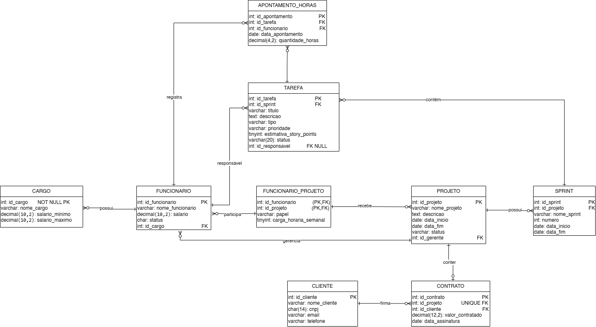

# SprintHub: Relatório técnico

## Capa e identificação

- **Projeto:** SprintHub - Gestão de Projetos de Software
- **Disciplina:** Banco de Dados
- **Curso:** Engenharia da Computação
- **Integrantes:** Jhonatan Pereira Mota, Ana Elisa Barbosa Cunha
- **SGBD:** MySQL 8.4 ou superior

## Resumo executivo

O SprintHub é uma base relacional de demonstração para gerenciar contratos e projetos de software. O modelo acompanha a equipe alocada, as sprints, as tarefas e o tempo registrado por funcionário, permitindo consultar dados operacionais e indicadores básicos.

O banco contém nove tabelas e usa chaves, restrições de domínio e relações referenciais para manter a consistência. Os scripts SQL e as consultas estão separados por finalidade na pasta `sql/`.

## Domínio e regras de negócio

O sistema representa clientes que contratam projetos. Cada projeto possui um gerente que é funcionário e pode ter sprints; cada sprint pertence a um projeto e contém tarefas. Funcionários podem participar de vários projetos, e cada alocação registra o papel e a carga horária semanal. Tarefas podem ter um responsável, e os funcionários registram horas trabalhadas nas tarefas.

## Povoamento

A carga em [`03_insercao_dados.sql`](../sql/03_insercao_dados.sql) fornece 15 cargos, 15 clientes, 20 funcionários, 15 projetos, 15 contratos, 30 alocações funcionário/projeto, 30 sprints, 30 tarefas e 30 apontamentos. Os dados são fictícios e foram preparados para exercitar as relações e consultas do modelo.

Regras principais implementadas:

1. Funcionário deve estar associado a um cargo; seu salário precisa ser positivo e seu status é ativo (`A`) ou desligado (`D`).
2. Projeto deve indicar um funcionário gerente; a data final, quando informada, não pode anteceder o início.
3. Contrato pertence a um cliente e a um projeto; o valor precisa ser positivo e há no máximo um contrato por projeto.
4. Uma combinação funcionário/projeto só pode aparecer uma vez em `funcionario_projeto`; a carga semanal por alocação fica entre 1 e 44 horas.
5. Cada sprint tem número positivo e único dentro do projeto, e sua data final deve ser posterior à inicial.
6. Tarefas têm tipo, prioridade, status e estimativa limitados a domínios definidos no DDL. O responsável é opcional.
7. Um apontamento registra de 0,25 a 12 horas e não pode ser repetido para o mesmo funcionário, tarefa e data.
8. A alocação de responsáveis e autores de apontamentos ao projeto é verificada pela consulta Q12; o DDL atual não impede diretamente essa incompatibilidade.

Os dados da carga são fictícios e foram preparados para demonstração.

## Diagrama entidade-relacionamento



O diagrama representa as nove tabelas, suas chaves e relações. A entidade `funcionario_projeto` resolve a relação N:N entre funcionários e projetos. `apontamento_horas` registra a associação entre funcionário e tarefa junto com atributos próprios do evento (data e horas).

## Dicionário de dados

O dicionário completo, com tipo, nulabilidade, restrições e descrição de cada campo, está em [`dicionario-de-dados.md`](dicionario-de-dados.md). Ele reflete as definições do DDL, inclusive os limites que não são impostos pelo esquema, como a soma semanal de alocações por funcionário.

## Normalização

O esquema foi organizado para atender às formas normais até a 3FN:

- **1FN:** cada coluna armazena um valor por registro; não há listas de cargos, tarefas ou funcionários dentro de uma única coluna.
- **2FN:** os atributos de `funcionario_projeto` dependem da chave composta funcionário/projeto, e não de apenas uma parte dela. Os dados específicos da alocação ficam nessa tabela associativa.
- **3FN:** atributos de cargo ficam em `cargo`, e funcionário guarda apenas a referência `id_cargo`; dados do cliente não são repetidos em `contrato`; tarefas referenciam sprints, que por sua vez referenciam projetos. Assim, os atributos descritivos de cada entidade permanecem junto à chave daquela entidade, evitando dependências transitivas nas tabelas dependentes.

Exemplo de decomposição: nome e faixa salarial do cargo não são repetidos em cada funcionário. `funcionario.id_cargo` referencia `cargo.id_cargo`, evitando que uma alteração no nome do cargo exija atualizar vários funcionários.

## Catálogo de consultas

O código SQL comentado de cada consulta está na seção indicada de [`04_consultas.sql`](../sql/04_consultas.sql). A tabela abaixo relaciona a consulta à pergunta de negócio e a um resultado esperado representativo, calculado a partir da massa de demonstração. As saídas devem ser confirmadas quando os scripts forem executados no MySQL.

| Nº | Pergunta respondida | SQL | Saída esperada representativa |
|---|---|---|---|
| Q01 | Quais funcionários estão ativos? | [Q01](../sql/04_consultas.sql#L23) | Lista de funcionários com status `A`, ordenada por nome. |
| Q02 | Quais projetos estão em andamento? | [Q02](../sql/04_consultas.sql#L36) | Projetos com status `Em andamento`, ordenados pela data inicial. |
| Q03 | Quais contratos estão entre R$ 80 mil e R$ 130 mil? | [Q03](../sql/04_consultas.sql#L49) | Contratos na faixa; por exemplo, o contrato 11, no valor de R$ 125.000. |
| Q04 | Quais tarefas críticas estão abertas ou em andamento? | [Q04](../sql/04_consultas.sql#L63) | Inclui, por exemplo, a tarefa 6, “Corrigir calculo de saldo”. |
| Q05 | Quais papéis aparecem nas alocações? | [Q05](../sql/04_consultas.sql#L78) | Lista sem duplicatas, incluindo “Gerente de projeto” e “Desenvolvedor”. |
| Q06 | Quais funcionários trabalham em cada projeto? | [Q06](../sql/04_consultas.sql#L91) | Linhas com funcionário, projeto, papel e carga horária. |
| Q07 | Quantas horas foram apontadas por projeto? | [Q07](../sql/04_consultas.sql#L108) | Agregados por projeto; “Serra ERP” totaliza 10 horas na amostra. |
| Q08 | Quanto cada cliente contratou? | [Q08](../sql/04_consultas.sql#L135) | Um contrato por cliente na amostra; o total do cliente BioNorte Laboratorios é R$ 120.000. |
| Q09 | Em quais projetos há tarefas críticas ainda abertas? | [Q09](../sql/04_consultas.sql#L156) | Inclui tarefas 6, 10, 14, 22 e 29. |
| Q10 | Quantas tarefas e qual a estimativa média por projeto? | [Q10](../sql/04_consultas.sql#L178) | Dois itens por projeto; “Serra ERP” tem média de 9 story points. |
| Q11 | Quais funcionários não têm alocação? | [Q11](../sql/04_consultas.sql#L206) | Vanessa Cardoso e William Teixeira. |
| Q12 | Há responsáveis ou autores de apontamentos sem alocação no projeto? | [Q12](../sql/04_consultas.sql#L224) | Nenhuma linha, se a carga atual for preservada. |
| Q13 | Quais títulos de tarefa contêm “Criar”? | [Q13](../sql/04_consultas.sql#L284) | Inclui tarefas 3, 9, 13 e 25. |
| Q14 | Quais são os cinco contratos de maior valor? | [Q14](../sql/04_consultas.sql#L298) | Começa pelos contratos 8 (R$ 175.000), 7 (R$ 150.000) e 14 (R$ 140.000). |
| Q15 | Quais contratos superam a média dos contratos? | [Q15](../sql/04_consultas.sql#L312) | Contratos acima de aproximadamente R$ 112.866,67; inclui o contrato 8. |

### Código SQL do catálogo

Os exemplos abaixo reproduzem as consultas do arquivo SQL separado, para que o catálogo do relatório também seja consultável sem sair deste documento.

#### Q01: Funcionários ativos

```sql
SELECT id_funcionario, nome_funcionario, salario, status
FROM funcionario
WHERE status = 'A'
ORDER BY nome_funcionario;
```

#### Q02: Projetos em andamento

```sql
SELECT id_projeto, nome_projeto, data_inicio, status
FROM projeto
WHERE status = 'Em andamento'
ORDER BY data_inicio;
```

#### Q03: Contratos por faixa de valor

```sql
SELECT id_contrato, id_cliente, id_projeto, valor_contratado, data_assinatura
FROM contrato
WHERE valor_contratado BETWEEN 80000 AND 130000
ORDER BY valor_contratado DESC;
```

#### Q04: Tarefas críticas em aberto

```sql
SELECT id_tarefa, titulo, prioridade, status, estimativa_story_points
FROM tarefa
WHERE prioridade = 'Critica'
  AND status IN ('Aberta', 'Em andamento')
ORDER BY estimativa_story_points DESC;
```

#### Q05: Papéis existentes

```sql
SELECT DISTINCT papel
FROM funcionario_projeto
ORDER BY papel;
```

#### Q06: Funcionários alocados por projeto

```sql
SELECT f.nome_funcionario, p.nome_projeto, fp.papel, fp.carga_horaria_semanal
FROM funcionario AS f
INNER JOIN funcionario_projeto AS fp
    ON fp.id_funcionario = f.id_funcionario
INNER JOIN projeto AS p
    ON p.id_projeto = fp.id_projeto
ORDER BY p.nome_projeto, f.nome_funcionario;
```

#### Q07: Horas apontadas por projeto

```sql
SELECT
    p.id_projeto,
    p.nome_projeto,
    ROUND(SUM(ah.quantidade_horas), 2) AS total_horas,
    COUNT(ah.id_apontamento) AS quantidade_apontamentos,
    ROUND(AVG(ah.quantidade_horas), 2) AS media_horas,
    MAX(ah.quantidade_horas) AS maior_apontamento,
    MIN(ah.quantidade_horas) AS menor_apontamento
FROM projeto AS p
INNER JOIN sprint AS s ON s.id_projeto = p.id_projeto
INNER JOIN tarefa AS t ON t.id_sprint = s.id_sprint
INNER JOIN apontamento_horas AS ah ON ah.id_tarefa = t.id_tarefa
GROUP BY p.id_projeto, p.nome_projeto
HAVING SUM(ah.quantidade_horas) > 0
ORDER BY total_horas DESC;
```

#### Q08: Valores contratados por cliente

```sql
SELECT
    c.id_cliente,
    c.nome_cliente,
    COUNT(ct.id_contrato) AS quantidade_contratos,
    ROUND(SUM(ct.valor_contratado), 2) AS total_contratado,
    ROUND(AVG(ct.valor_contratado), 2) AS valor_medio
FROM cliente AS c
INNER JOIN contrato AS ct ON ct.id_cliente = c.id_cliente
GROUP BY c.id_cliente, c.nome_cliente
HAVING SUM(ct.valor_contratado) >= 80000
ORDER BY total_contratado DESC;
```

#### Q09: Tarefas críticas abertas por projeto

```sql
SELECT
    p.nome_projeto,
    s.numero,
    s.nome_sprint,
    t.id_tarefa,
    t.titulo,
    t.prioridade,
    t.status
FROM tarefa AS t
INNER JOIN sprint AS s ON s.id_sprint = t.id_sprint
INNER JOIN projeto AS p ON p.id_projeto = s.id_projeto
WHERE t.prioridade = 'Critica'
  AND t.status IN ('Aberta', 'Em andamento')
ORDER BY p.nome_projeto, s.numero;
```

#### Q10: Indicadores de tarefas por projeto

```sql
SELECT
    p.id_projeto,
    p.nome_projeto,
    COUNT(t.id_tarefa) AS quantidade_tarefas,
    ROUND(AVG(t.estimativa_story_points), 2) AS media_estimativa,
    MAX(t.estimativa_story_points) AS maior_estimativa,
    MIN(t.estimativa_story_points) AS menor_estimativa
FROM projeto AS p
INNER JOIN sprint AS s ON s.id_projeto = p.id_projeto
INNER JOIN tarefa AS t ON t.id_sprint = s.id_sprint
GROUP BY p.id_projeto, p.nome_projeto
HAVING COUNT(t.id_tarefa) >= 1
ORDER BY media_estimativa DESC;
```

#### Q11: Funcionários sem alocação

```sql
SELECT f.id_funcionario, f.nome_funcionario, f.status, c.nome_cargo
FROM funcionario AS f
INNER JOIN cargo AS c ON c.id_cargo = f.id_cargo
LEFT JOIN funcionario_projeto AS fp ON fp.id_funcionario = f.id_funcionario
WHERE fp.id_funcionario IS NULL
ORDER BY f.nome_funcionario;
```

#### Q12: Auditoria de alocação

```sql
SELECT
    'Responsável sem alocação' AS tipo_inconsistencia,
    t.id_tarefa,
    f.id_funcionario,
    f.nome_funcionario,
    p.id_projeto,
    p.nome_projeto
FROM tarefa AS t
INNER JOIN sprint AS s ON s.id_sprint = t.id_sprint
INNER JOIN projeto AS p ON p.id_projeto = s.id_projeto
INNER JOIN funcionario AS f ON f.id_funcionario = t.id_responsavel
LEFT JOIN funcionario_projeto AS fp
    ON fp.id_funcionario = f.id_funcionario
   AND fp.id_projeto = p.id_projeto
WHERE fp.id_funcionario IS NULL

UNION ALL

SELECT
    'Autor sem alocação' AS tipo_inconsistencia,
    t.id_tarefa,
    f.id_funcionario,
    f.nome_funcionario,
    p.id_projeto,
    p.nome_projeto
FROM apontamento_horas AS ah
INNER JOIN tarefa AS t ON t.id_tarefa = ah.id_tarefa
INNER JOIN sprint AS s ON s.id_sprint = t.id_sprint
INNER JOIN projeto AS p ON p.id_projeto = s.id_projeto
INNER JOIN funcionario AS f ON f.id_funcionario = ah.id_funcionario
LEFT JOIN funcionario_projeto AS fp
    ON fp.id_funcionario = f.id_funcionario
   AND fp.id_projeto = p.id_projeto
WHERE fp.id_funcionario IS NULL
ORDER BY tipo_inconsistencia, id_tarefa;
```

#### Q13: Busca de tarefas por título (`LIKE`)

```sql
SELECT id_tarefa, titulo, status, prioridade
FROM tarefa
WHERE titulo LIKE '%Criar%'
ORDER BY titulo;
```

#### Q14: Cinco contratos de maior valor (`LIMIT`)

```sql
SELECT id_contrato, id_projeto, valor_contratado, data_assinatura
FROM contrato
ORDER BY valor_contratado DESC, id_contrato ASC
LIMIT 5;
```

#### Q15: Contratos acima da média (subconsulta)

```sql
SELECT
    ct.id_contrato,
    c.nome_cliente,
    p.nome_projeto,
    ct.valor_contratado
FROM contrato AS ct
INNER JOIN cliente AS c ON c.id_cliente = ct.id_cliente
INNER JOIN projeto AS p ON p.id_projeto = ct.id_projeto
WHERE ct.valor_contratado > (
    SELECT AVG(valor_contratado)
    FROM contrato
)
ORDER BY ct.valor_contratado DESC;
```

## Instruções de execução

Com MySQL 8.4 ou superior instalado, abra o cliente na raiz do projeto e execute, nessa ordem:

```sql
SOURCE sql/01_criacao_banco.sql;
SOURCE sql/02_criacao_tabelas.sql;
SOURCE sql/03_insercao_dados.sql;
SOURCE sql/04_consultas.sql;
```

O script DML usa IDs fixos e não é idempotente: não o execute novamente sobre a mesma carga. O esquema deve ser preparado em uma instância limpa para a demonstração; confirme o banco de destino antes de qualquer operação de limpeza.

## Considerações finais

O projeto demonstra relações 1:1, 1:N e N:N, restrições de integridade e consultas de diferentes níveis. Possíveis evoluções incluem impor por mecanismo de banco a compatibilidade das alocações com responsáveis/apontamentos, validar a soma semanal de horas por funcionário e registrar um histórico de status e alterações.

## Referências

- MySQL. *MySQL 8.4 Reference Manual*. <https://dev.mysql.com/doc/refman/8.4/en/>
